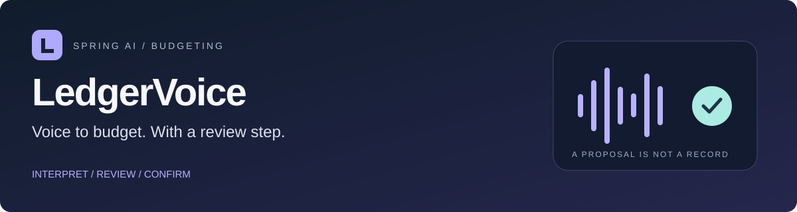

# LedgerVoice

A budgeting API that turns a spoken or written command into a **reviewable transaction proposal**. Spring AI interprets the request and calls a real application tool. The ledger changes only after the user confirms the proposal through a separate endpoint.

An original implementation of the [DIO Spring AI budgeting challenge](https://github.com/digitalinnovationone/dio-spring-boot-learning-track/tree/main/05-spring-ai), with a focused extension: **explicit review, database-backed confirmation replay and atomic audit records**.

**Java 17 · Spring Boot 4.1.1 · Spring AI 2.0.1 · JDBC · Flyway · H2 · JUnit Jupiter · Maven Wrapper**

[Architecture](docs/architecture.md) · [OpenAPI contract](docs/openapi.yaml) · [HTTP examples](docs/requests.http) · [Verification](docs/quality-report.md) · [Guia em português](docs/guia-pt-br.md)

## What the project demonstrates

- Audio upload, speech-to-text, `ChatClient` and annotated `@Tool` methods.
- A tool allowlist that can prepare a proposal and read data; confirmation is outside the model's capabilities.
- Shared domain validation for manual requests and model-generated arguments.
- A 15-minute review window and repeatable confirmation without duplicate ledger entries.
- Decimal money, date rules, category filters, pagination and exact monthly totals from confirmed records.
- A schema migration and an audit trail committed in the same database transaction as the financial record.
- Text-to-speech as a separate MP3 endpoint, with its AI origin disclosed in a response header.

This is a **local, single-user reference**, not a financial service or a public SaaS. All amounts are BRL. There is no bank integration, payment execution, authentication or tenant isolation. Use synthetic data. [Security and data handling](SECURITY.md) describes the boundaries.

## Two execution modes

| Mode | Interpretation | Audio | Credentials |
|---|---|---|---|
| Default / `demo` | Deterministic, documented text grammar using the same application tools | Returns a clear `503`; no fabricated transcript or speech | None |
| `live` | Spring AI + OpenAI model selects the tool and its arguments | Transcription and generated MP3 through Spring AI | Server-side `OPENAI_API_KEY` and access to the configured models |

Demo is not an AI model. It makes the ledger workflow reproducible without provider access. Live requests send content to the configured provider and can incur charges. The automated suite uses a local HTTP provider fixture; it does not measure real model accuracy or voice quality.

## Run without an API key

Requirements: **JDK 17+**, an internet connection for the first Maven/dependency download, and a terminal. JDK 17 is the executed baseline. A separate Maven installation is unnecessary.

```bash
git clone https://github.com/ricciarellidev/ledgervoice-spring-ai.git
cd ledgervoice-spring-ai
bash ./mvnw --batch-mode --no-transfer-progress clean verify
java -jar target/ledgervoice-1.0.0.jar
```

On Windows, use `mvnw.cmd clean verify` for the build. The API binds to loopback on `http://localhost:8080`.

```bash
curl --fail http://localhost:8080/actuator/health
```

The first startup applies the Flyway migration and creates the H2 file database under `var/`. Restarting preserves proposals, confirmed records and audit events. The database directory is ignored by Git and absent from the source delivery.

## Walk through the review boundary

Prepare a demo expense for today in the application's `America/Sao_Paulo` timezone:

```bash
curl --request POST http://localhost:8080/api/v1/assistant/commands \
  --header 'Content-Type: application/json' \
  --data '{"text":"despesa;42,90;FOOD;Almoço;hoje"}'
```

The JSON response includes `mode: DEMO`, `requiresConfirmation: true`, a proposal ID, its typed draft and expiry time. The server reply makes clear that no ledger entry exists yet.

```bash
curl http://localhost:8080/api/v1/summary
```

Pending proposals do not appear in totals. Review the response, then copy `proposals[0].id` into `PROPOSAL_ID`:

```bash
PROPOSAL_ID='replace-with-the-reviewed-proposal-id'
curl --include --request POST "http://localhost:8080/api/v1/proposals/$PROPOSAL_ID/confirm"
curl "http://localhost:8080/api/v1/proposals/$PROPOSAL_ID/audit"
curl http://localhost:8080/api/v1/summary
```

The first confirmation returns `201 Created` and `Confirmation-Replayed: false`. Repeat it: `200 OK`, `Confirmation-Replayed: true` and the same transaction receipt. Confirming an expired pending proposal returns `410 Gone`. Confirmed receipts remain replayable after their review window.

This replay guarantee applies to **one proposal ID**. Resubmitting a command creates a new proposal; the system does not deduplicate equivalent sentences or recordings. Review repeated proposals before confirming.

### Demo command grammar

| Command | Meaning |
|---|---|
| `despesa;42,90;FOOD;Almoço;hoje` | Prepare an expense proposal |
| `receita;3500.00;SALARY;Salário;2026-10-01` | Prepare an income proposal with an explicit date |
| `resumo;2026-10` | Query confirmed monthly totals |
| `listar;2026-10;FOOD` | List up to 20 confirmed food records |
| `listar;2026-10;ALL` | List up to 20 confirmed records across categories |

Money may use a comma or dot in demo text. Live tool arguments and JSON monetary fields use a dot. Dates use `yyyy-MM-dd`; query periods use `yyyy-MM`. Unknown commands produce guidance without changing the ledger.

## Run with Spring AI

Stop the demo process before starting live mode on the same port and database.

```bash
export OPENAI_API_KEY='your-server-side-api-key'
java -jar target/ledgervoice-1.0.0.jar --spring.profiles.active=live
```

In PowerShell: `$env:OPENAI_API_KEY = 'your-server-side-api-key'`, followed by the same `java -jar ... --spring.profiles.active=live` command. A missing key fails configuration validation. Never put a real key in source, an HTTP example or a GitHub secret just to run this test suite.

Natural-language example:

```bash
curl --request POST http://localhost:8080/api/v1/assistant/commands \
  --header 'Content-Type: application/json' \
  --data '{"text":"Registre meu almoço de 42 reais e 90 centavos em alimentação hoje."}'
```

Upload a recording containing a complete instruction:

```bash
curl --request POST http://localhost:8080/api/v1/assistant/audio \
  --form 'file=@/path/to/your/command.wav'
```

The response contains the transcript and a typed proposal or query result. A transcript is not retained in the application database. WAV, MP3, M4A and WebM are accepted up to 5 MiB, with extension/header checks. These checks are not a complete audio decoder or a malware scan.

Generate an optional spoken response after reading the JSON answer:

```bash
curl --fail --request POST http://localhost:8080/api/v1/assistant/speech \
  --header 'Content-Type: application/json' \
  --data '{"text":"Proposta pronta para revisão. Confira os dados antes de confirmar."}' \
  --output response.mp3
```

This is **AI-generated speech**; disclose that origin when playing it to someone. A successful response carries `X-Audio-Origin: AI-generated`. Text-to-speech is a separate request and never confirms a proposal.

| Variable | Default in live mode |
|---|---|
| `OPENAI_API_KEY` | Required; no supplied key |
| `OPENAI_BASE_URL` | `https://api.openai.com/v1` |
| `OPENAI_CHAT_MODEL` | `gpt-4.1-mini` |
| `OPENAI_TRANSCRIPTION_MODEL` | `gpt-4o-mini-transcribe` |
| `OPENAI_SPEECH_MODEL` | `gpt-4o-mini-tts` |
| `LEDGER_DB_URL` | Local H2 file URL from application.yml |

Model names are configurable; availability depends on the provider account. Provider request timeouts are 30 seconds and automatic transport retries are disabled. Tools return directly, with at most one successful application operation per command; there is no multi-turn chat memory.

## API surface

| Endpoint | Behavior |
|---|---|
| `POST /api/v1/assistant/commands` | Interpret text and return typed tool results |
| `POST /api/v1/assistant/audio` | Transcribe a multipart file, then interpret it |
| `POST /api/v1/assistant/speech` | Generate MP3 from up to 1000 characters |
| `POST /api/v1/proposals` | Prepare a structured manual proposal using the same rules |
| `GET /api/v1/proposals/{id}` | Inspect the proposal, state and expiry |
| `POST /api/v1/proposals/{id}/confirm` | Commit once, or replay the existing receipt |
| `GET /api/v1/proposals/{id}/audit` | Read up to 100 newest audit events |
| `GET /api/v1/transactions/{id}` | Retrieve a confirmed record |
| `GET /api/v1/transactions` | Query by month/category with bounded pagination |
| `GET /api/v1/summary` | Exact income, expense and net totals for a month |

`GET /transactions` accepts `month`, `category`, `page` and `size`. The default month is the current application month; size defaults to 20 and is capped at 100. The page range is 0–10000. Only confirmed transactions are queried.

Errors use RFC 9457 Problem Detail, with an application `code` and `correlationId`. Syntax/field errors are `400`, domain rejection is `422`, missing records are `404`, expiry is `410`, upload limit is `413`, unavailable demo audio is `503`, and upstream AI failure is `502`. Assistant clarification results use `200` and contain no new proposal. Internal faults return a sanitized `500`.

The OpenAPI document is a checked-in contract; no runtime Swagger UI is claimed. HTTP examples include review, replay, queries, invalid requests and both execution modes.

## Design and evidence

The domain package uses JDK types only. The application layer coordinates validation, persistence and audit; JDBC and AI are adapters. `BudgetTools` is created per request, so proposal/query results are not shared between concurrent conversations. Server-generated answers reflect real tool results and do not trust a model's unsupported claim that data was saved.

`LedgerService.confirm` takes a database row lock. A unique `transactions.proposal_id` constraint provides another guard. The ledger row, proposal link and confirmation audit event share one transaction. Tests inject an audit failure to verify rollback and issue concurrent confirmations to verify one committed record.

Run `clean verify` to build the executable JAR, execute tests and enforce **90% scoped line coverage / 75% scoped branch coverage**. DTOs, configuration and the bootstrap class are excluded from coverage ratios, with wiring/serialization exercised by integration tests. [quality-report.md](docs/quality-report.md) records results and untested areas. GitHub Actions runs the same command without real provider keys.

## Optional Docker workflow

```bash
docker compose up --build
```

Compose defaults to demo and publishes the port on host loopback. A named volume preserves the H2 database. The application container runs as a non-root user. For live mode, copy `.env.example` to an ignored `.env`, set the profile and key locally, then recreate the container. Native Java does not automatically read `.env`.

Docker build/execution was not available in the recorded environment; these files are supplied configuration, not a tested deployment claim. Do not run multiple application processes against the same embedded H2 file.

## Learning notes and attribution

The DIO project provided the challenge and architectural reference. This version uses stable Spring AI 2.0.1, the Boot 4.1.1 baseline used by that release, Maven Wrapper and JDK 17. The course example inspected during development used an earlier Spring AI milestone and Gradle/JDK 25; its source code and audio fixtures are not bundled here.

The [Portuguese guide](docs/guia-pt-br.md) explains the improvement, a presentation walkthrough and the concepts practiced: tool capability boundaries, monetary validation, database transactions, schema migrations and the difference between a provider contract test and a model-quality evaluation.

References: [DIO track](https://github.com/digitalinnovationone/dio-spring-boot-learning-track), [Spring AI tools](https://docs.spring.io/spring-ai/reference/api/tools.html), [ChatClient](https://docs.spring.io/spring-ai/reference/api/chatclient.html), [audio transcription](https://docs.spring.io/spring-ai/reference/api/audio/transcriptions/openai-transcriptions.html), [speech](https://docs.spring.io/spring-ai/reference/api/audio/speech/openai-speech.html), [Spring AI 2.0.1 source](https://github.com/spring-projects/spring-ai/tree/v2.0.1), [RFC 9457](https://www.rfc-editor.org/rfc/rfc9457.html).

MIT licensed; see [LICENSE](LICENSE). A source handoff can be checked with `sha256sum --check FILES.sha256`. The manifest is a delivery snapshot and excludes itself and build output; regenerate it after intentional source changes.
