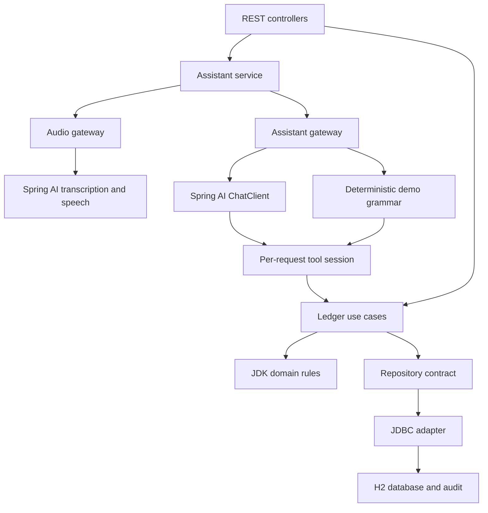
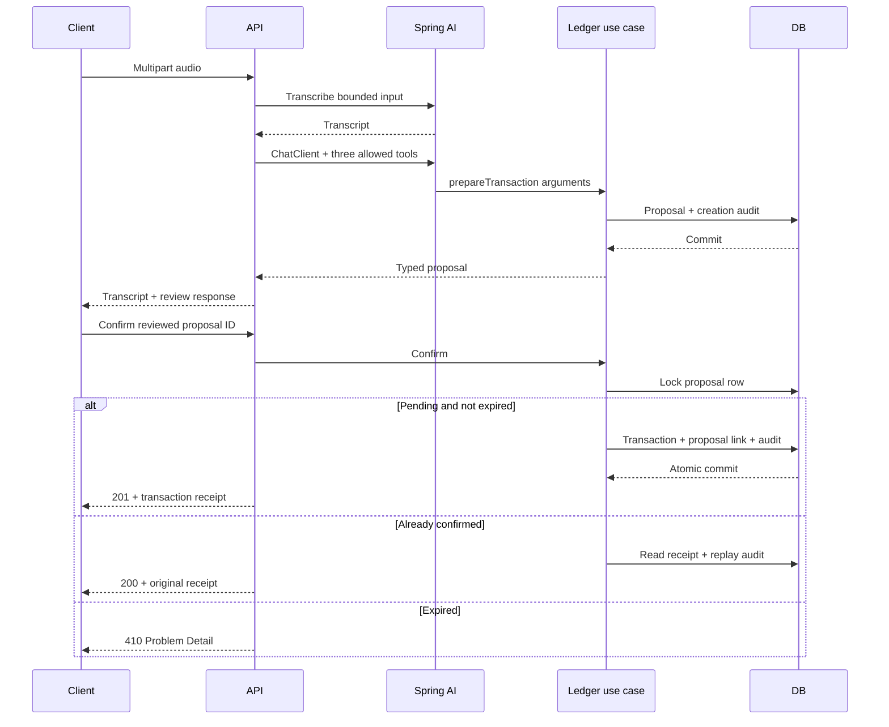

# Design notes

## The improvement

The DIO budgeting challenge connects voice, an AI model and financial use cases. LedgerVoice adds a review boundary: interpretation can create a proposal, and a separate explicit request commits that proposal. The same workflow serves structured REST input and AI tool arguments.

A model can misunderstand an amount, date or category while still producing syntactically valid data. Domain validation checks structural/business rules; human review checks whether the proposal matches the person's intent. Neither replaces authentication or a model-quality evaluation.

## Responsibilities

| Layer | Owns | Does not own |
|---|---|---|
| `domain` | Values, monetary/date rules, query results and repository contract | Spring, HTTP, provider SDKs |
| `application` | Preparation, confirmation, queries and audio/text orchestration | SQL and model-specific options |
| `infrastructure.ai` | Spring AI adapters, bounded tool session and demo grammar | Direct transaction confirmation |
| `infrastructure.persistence` | Parameterized SQL and row mapping | User intent |
| `web` | HTTP validation, upload allowlist, status/headers and errors | Provider-specific credentials or SQL |
| `config` | Clock, provider settings and live model construction | Financial rules |

The application layer deliberately uses Spring transactions. This is a layered design with a JDK-only domain, not a claim that the entire application is framework independent.

## Voice and review sequence

MP3 synthesis is an optional separate call. It reads text; it cannot commit a record. Audio and transcript content are not stored in the application database. The servlet may create temporary upload files during the request.

## Decision: capabilities are explicit

Each command creates a fresh `BudgetTools` instance. Only three annotated methods are registered: `prepareTransaction`, `monthlySummary`, `listTransactions`. The model has no confirmation, deletion, filesystem, SQL execution or credential-reading tool.

Every exposed tool sets `returnDirect = true`, using Spring AI 2's tool-calling advisor rather than deprecated model-level tool execution. The adapter does not use the provider's prose as the source of truth. It returns the actual typed result collected by the tool session. A model message claiming “saved” without a tool call produces clarification and no write.

Parallel tool calls are disabled in provider options, and the session permits one successful application operation. Extra calls return a limit result without running another use case. Transport retries are disabled. Transcription, chat and speech each have a 30-second request timeout. A voice operation can take more than one timeout interval because it has distinct provider stages; no single global request deadline is claimed.

Natural-language requests are stateless. There is no chat memory, multi-user session, vector database or RAG implementation. Unknown/malformed tool selections can fail the command; valid but rejected arguments produce clarification. Prompt rules help interpretation, but the capability boundary and domain rules provide the enforceable controls.

## Decision: confirmation is a database transaction

`LedgerService.confirm` runs inside a Spring transaction and acquires `SELECT ... FOR UPDATE` on the proposal row. The first caller inserts a transaction, links the proposal and appends its audit event. A second caller waits, observes the confirmed link and returns the same record.

A unique constraint on `transactions.proposal_id` prevents multiple records for one proposal. If insertion, linking or audit fails, the transaction rolls back. This is tested with an injected audit failure against the actual JDBC/database path, not an in-memory repository mock.

Confirmation is naturally idempotent for the proposal ID and survives a local process restart because state is in the file database. A new command creates a different proposal ID, even when its sentence matches an earlier command. Equivalent commands, recordings or business expenses are not deduplicated.

The guarantee is a local H2 database guarantee with one application process. This project has not verified distributed deployment, multiple application nodes, remote database failover or crash recovery during filesystem corruption.

## Decision: money and time are normalized

All amounts use `BigDecimal`, are positive, have at most two significant decimal places and are capped at 1000000.00. The use case normalizes values to scale 2 before storing a proposal; the schema repeats amount constraints. No binary floating-point calculation occurs in the application ledger.

Amounts have a direction (`INCOME` or `EXPENSE`); they are not stored as negative expenses. Totals are exact SQL sums, and net is income minus expenses. Only confirmed rows participate. The currency is BRL; there is no conversion or inferred exchange rate.

Dates range from 2000-01-01 through today in `America/Sao_Paulo`. Future bookings are outside scope. Query months use `yyyy-MM` and are limited to 2000–2100. Creation/audit timestamps are UTC instants truncated to microseconds, matching database precision so replayed receipt bytes remain stable.

Review lasts 15 minutes. An expired pending proposal cannot be confirmed. A confirmed receipt remains replayable after expiry. An injected `Clock` makes boundary tests deterministic.

## Persistence and audit

Flyway owns the schema. JDBC queries bind user values as parameters. Optional category filtering adds a fixed SQL fragment; no raw user text is concatenated into SQL.

The default H2 file lives under `var/`, with no external database service required. H2 memory databases are used for tests. The stored audit actions are `PROPOSAL_CREATED`, `TRANSACTION_CONFIRMED` and `CONFIRMATION_REPLAYED`. Audit rows retain IDs/action/time, not transcripts, provider keys or full command text.

The audit endpoint returns the newest 100 events, ordered by timestamp and ID. It is an application history, not a cryptographic, immutable or compliance-certified audit log. The local database owner can modify files. No purge, backup scheduler or retention enforcement is provided.

## API and operating limits

HTTP DTO validation rejects missing fields and invalid precision before the use case. Domain validation also protects the AI path. Errors use RFC 9457 with sanitized detail and a correlation ID; rejected values and exception traces are not echoed. Application logging avoids request content and provider credentials.

Audio is limited to 5 MiB. File extensions and leading container signatures are checked, and the provider receives a server-controlled filename. This is a coarse allowlist, not proof that the entire media is decodable or safe.

The default server and Compose host port bind to loopback. There is no authentication or tenant isolation. “Review required” expresses user intent; it does not verify user identity. Before a public service, add authentication, authorization, rate limits, data protection, retention, provider usage controls and deployment-specific tests. The current application is a local portfolio reference.

## Extension choices

Small compatible next changes include adding a read-only category breakdown or a richer live evaluation dataset. A remote database migration requires testing its lock/isolation behavior and schema dialect. New model-visible mutations require a new explicit consent policy; confirmation should remain unavailable as an AI tool.
